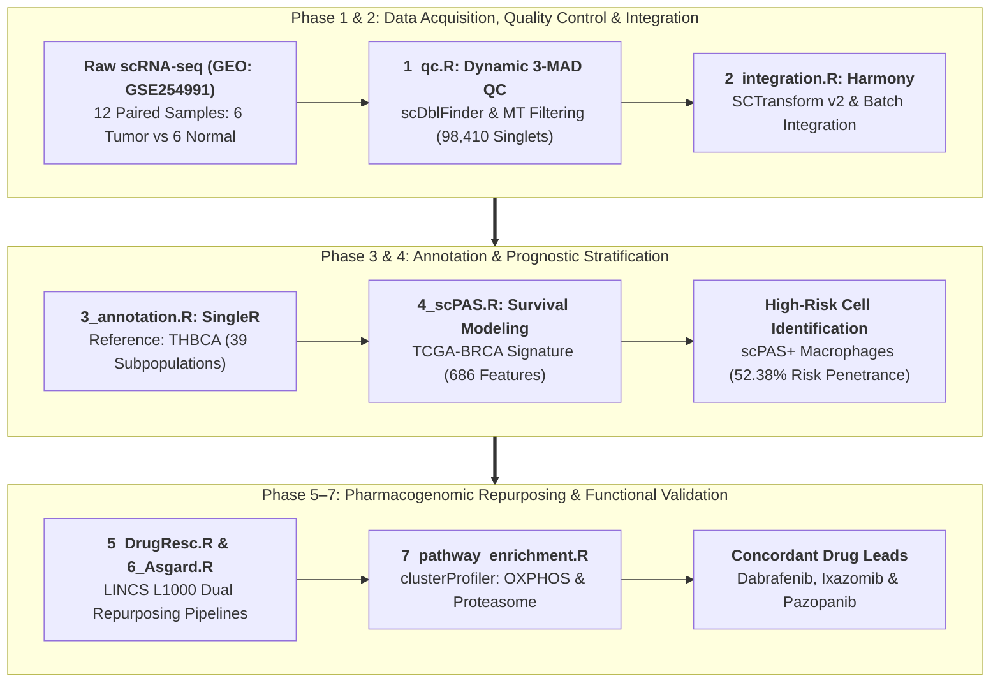
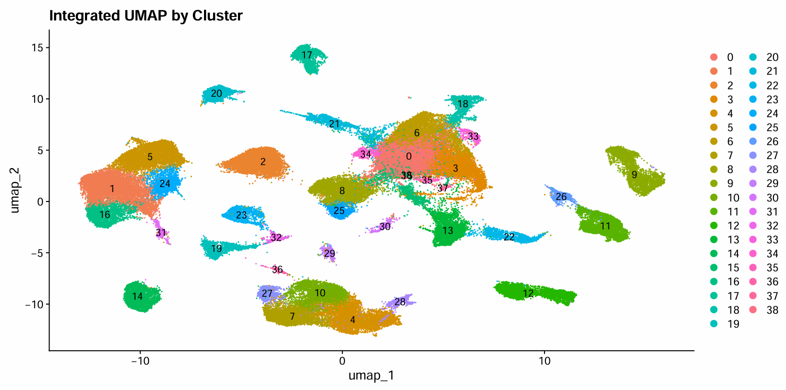
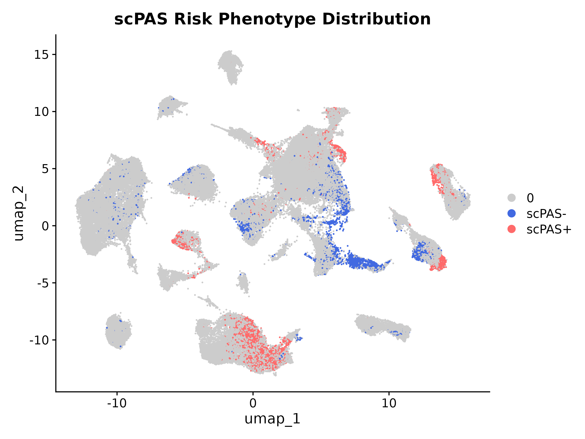
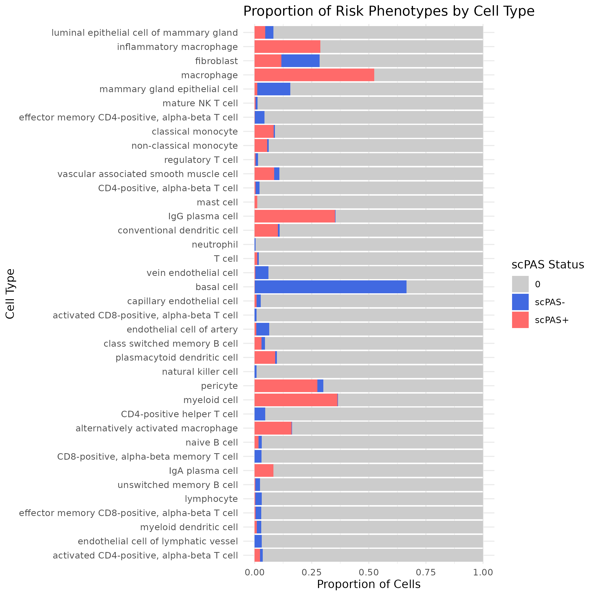
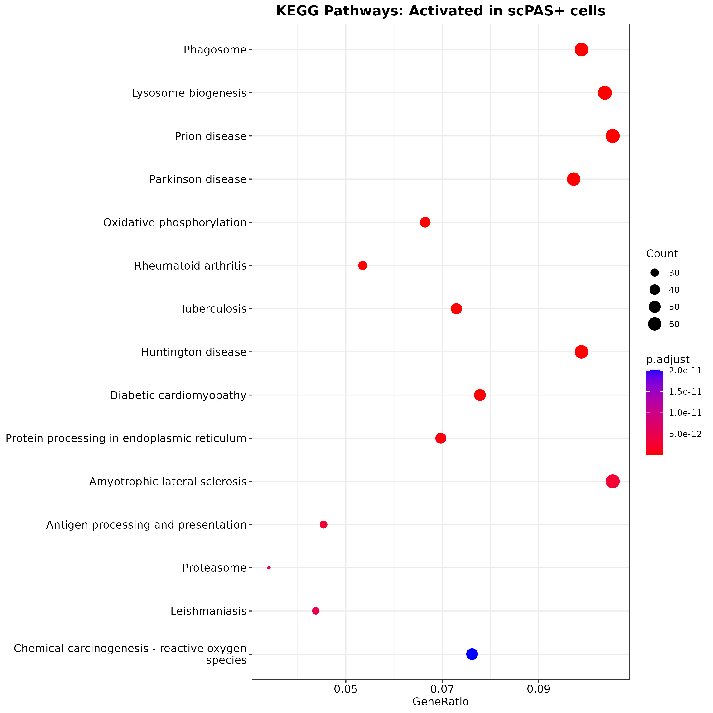
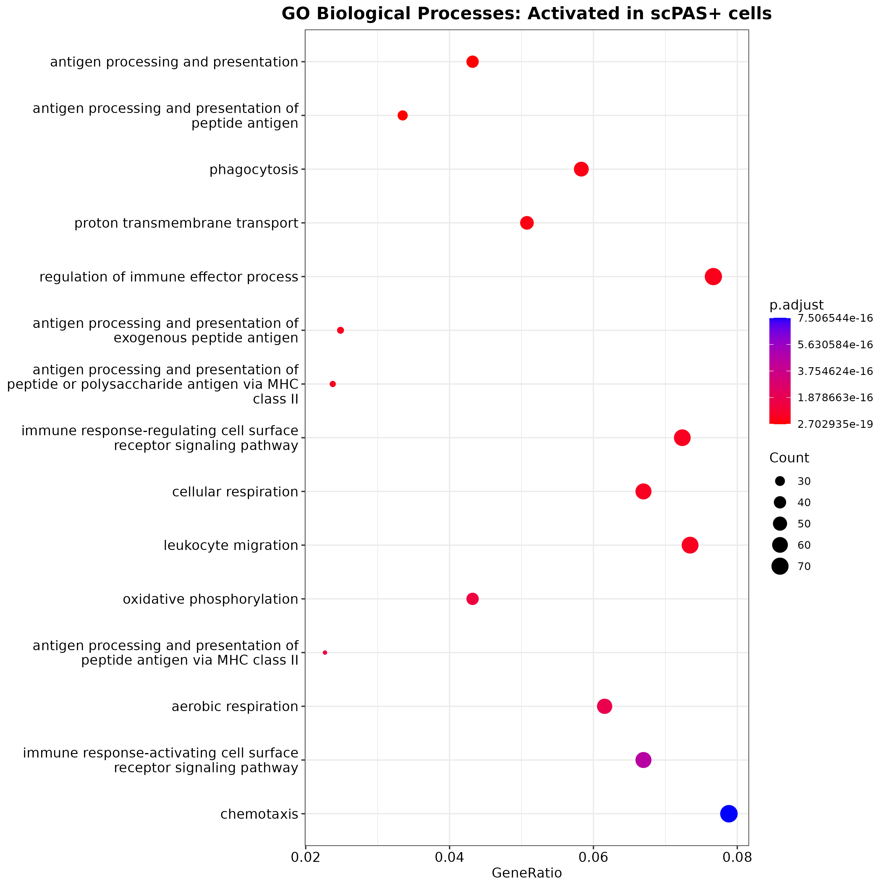

# Targeting High-Risk Macrophage Phenotypes in the Breast Cancer Microenvironment: A Single-Cell Transcriptomic and Drug Repurposing Analysis

**Author(s):** Md Abu Sadat Soash, Raphael Kabir Niloy    
*Department of Genetic Engineering and Biotechnology*<br>
*Shahjalal University of Science and Technology, Sylhet, Bangladesh*

[](https://www.r-project.org/)
[](https://satijalab.org/seurat/)
[](https://github.com/immunogenomics/harmony)
[](https://github.com/Xing-Zhao-Lab/scPAS)
[](https://www.ncbi.nlm.nih.gov/geo/query/acc.cgi?acc=GSE254991)
[](https://clue.io/)

---

## Abstract

* **Objective:** The tumor microenvironment (TME) of breast cancer harbors diverse, functionally specialized cellular states that govern therapeutic resistance and disease progression. This study aims to identify prognostic immune subpopulations driving poor clinical outcomes and rationally discover candidate therapeutics capable of reversing their immunosuppressive transcriptomic signatures.
* **Methodology:** We obtained high-resolution single-cell RNA sequencing (scRNA-seq) data spanning 12 paired samples (6 primary breast tumors and 6 matched adjacent normal tissues; 98,410 high-quality singlets). We integrated the cellular landscape using **Seurat v5** and **Harmony**, mapped subpopulations against The Human Breast Cancer Atlas (**THBCA**), and trained the Single-Cell Phenotype-Associated Signatures (**scPAS**) algorithm on TCGA-BRCA patient cohorts. For translational drug discovery, we deployed dual *in silico* repurposing pipelines (**DrugReSC** and **ASGARD**) against the **LINCS L1000** perturbational compendium.
* **Findings:** Tumor-associated macrophages (TAMs) emerged as the dominant prognostic culprit, with **52.38%** exhibiting the high-risk (`scPAS+`) survival phenotype. Pathway enrichment revealed that these high-risk macrophages are hyper-metabolic, exhibiting pronounced activation of **Oxidative Phosphorylation (OXPHOS)**, **Proteasome**, **Phagosome**, and **Lysosome** pathways. Dual computational drug screening independently converged on targeted kinase inhibitors (**Dabrafenib**, **Vemurafenib**, **Imatinib**, **Pazopanib**) and proteasome inhibitors (**Ixazomib**) as top candidates capable of neutralizing the immunosuppressive niche.
* **Implications:** This single-cell pharmacogenomic framework identifies specific cellular targets and actionable FDA-approved candidate drugs to overcome macrophage-mediated immunosuppression and enhance breast cancer immunotherapy regimens.

---

## Biological Background & Motivation

The breast cancer tumor microenvironment is an intricate ecosystem composed of malignant epithelial cells, stromal components, and infiltrating immune populations. Among immune infiltrates, tumor-associated macrophages (TAMs) frequently switch from anti-tumorigenic states toward immunosuppressive, pro-angiogenic phenotypes that shield cancer cells from cytotoxic lymphocyte surveillance and promote therapeutic failure.

```
       Breast Cancer Tumor Microenvironment (TME)
                          │
              ┌───────────┴───────────┐
              ▼                       ▼
    Malignant Epithelial     Metabolic Stress &
    Driver Mutations         Hypoxic Niches
              │                       │
              ▼                       ▼
   Immunosuppressive TME     OXPHOS & Proteasome
   Macrophage Recruitment       Hyperactivation
              │                       │
              └───────────┬───────────┘
                          ▼
                 scPAS+ Macrophages
              (Dominant High-Risk State)
                          │
                          ▼
      Immune Evasion, Metastatic Seeding &
           Poor Patient Survival (TCGA)
```

1. **Macrophage Heterogeneity & Immunosuppression:** Rather than conforming to binary M1/M2 paradigms, TAMs display a continuum of plastic activation states. In advanced breast carcinoma, metabolically reprogrammed macrophages drive extracellular matrix remodeling, suppress cytotoxic CD8+ T-cell infiltration, and trigger immune checkpoint resistance.
2. **The Clinical Prognostic Dilemma:** Standard bulk transcriptomics obscures rare, high-risk cellular subpopulations by averaging expression across heterogeneous biopsies. Coupling single-cell transcriptomics with machine-learning survival modeling (**scPAS**) allows direct mapping of bulk TCGA-BRCA patient survival metrics back to individual single-cell phenotypes.
3. **Dual In Silico Repurposing Rationale:** Translating single-cell signatures into therapies requires computational consensus. By combining **DrugReSC** (AUCell Random Forest classification) with **ASGARD** (cluster-specific tumor vs. normal perturbation matching), this study establishes cross-validated therapeutic leads targeting high-risk TAM vulnerabilities.

---

## Computational Pipeline Architecture



---

## Key Findings

### 1. Cellular Landscape & Prognostic Risk Distribution

Stratification of **98,410 single cells** across 39 annotated subsets using the `scPAS` survival model revealed that **8,151 cells (8.28%)** exhibit the high-risk prognostic signature, with macrophages displaying the highest phenotypic penetrance:

| Cell Type / Subpopulation | Total Single Cells | High-Risk (`scPAS+`) Count | Within-Cell-Type Risk (%) | Biological Significance in Breast TME |
| :--- | :---: | :---: | :---: | :--- |
| **Macrophages** | 1,489 | **780** | **52.38%** | Dominant driver of poor survival; hyper-metabolic immunosuppressive state |
| **Myeloid cells** | 1,220 | **443** | **36.31%** | Immature antigen-presenting and myeloid-derived suppressor populations |
| **IgG+ Plasma cells** | 4,213 | 1,481 | 35.15% | Dysregulated humoral response in tumor periphery |
| **Inflammatory Macrophages** | 2,752 | 791 | 28.74% | Pro-inflammatory cytokine-secreting subset |
| **Pericytes** | 1,179 | 324 | 27.48% | Vascular mural cells involved in tumor neo-angiogenesis |
| **Endothelial cells** | 7,163 | 1,842 | 25.72% | Tumor vascular remodeling and extravasation niches |
| **Monocytes** | 4,281 | 851 | 19.88% | Circulating precursors recruited into tumor parenchyma |
| **Fibroblasts / CAFs** | 4,499 | 433 | 9.62% | Extracellular matrix deposition and desmoplastic stroma |
| **T cells & NK cells** | 42,912 | 794 | 1.85% | Predominantly baseline/protective cytotoxic and helper lineages |

### 2. Dual-Pipeline Prioritized Drug Repurposing Candidates

Screening against the **Broad Institute LINCS L1000** perturbational repository using two orthogonal computational algorithms yielded consensus therapeutic candidates:

| Pipeline | Rank | Candidate Drug | Primary Mechanism of Action / Target | Predictive Score / Statistical Significance |
| :--- | :---: | :--- | :--- | :--- |
| **DrugReSC** | **1** | **Dabrafenib** | BRAF Kinase Inhibitor | Score: **1.000** |
| **DrugReSC** | **2** | **Vemurafenib** | BRAF Kinase Inhibitor | Score: **0.988** *(6 of top 10 signatures)* |
| **DrugReSC** | **5, 7** | **Imatinib** | BCR-ABL / c-KIT / PDGFR Inhibitor | Top 10 High-Confidence Hit |
| **ASGARD** | **1** | **Mitoxantrone** | Topoisomerase II Inhibitor / Intercalator | Score: **Inf** ($FDR < 10^{-29}$) |
| **ASGARD** | **2** | **Vorinostat** | Histone Deacetylase (HDAC) Inhibitor | Score: **Inf** ($FDR < 10^{-80}$) |
| **ASGARD** | **3** | **Mebendazole** | Microtubule Polymerization Inhibitor | Score: **0.562** |
| **ASGARD** | **4** | **Ixazomib** | 20S Proteasome Inhibitor | Score: **0.367** *(Directly targets enriched Proteasome pathway)* |
| **ASGARD** | **5** | **Pazopanib** | Multi-tyrosine Kinase Inhibitor (VEGFR/PDGFR/KIT) | Score: **0.303** |

### 3. Mechanistic Rationale for Top Translational Hits

```
                     ┌────────────────────────────────────────┐
                     │          Ixazomib (ASGARD Hit)         │
                     │          ─────────────────────         │
                     │  • Targets 20S proteasome core         │
                     │  • Blocks hyperactive protein turnover │
                     │  • Direct match to KEGG Proteasome hit │
                     └────────────────────────────────────────┘

                     ┌────────────────────────────────────────┐
                     │        Dabrafenib (DrugReSC Hit)       │
                     │        ─────────────────────────       │
                     │  • Inhibits hyperactive MAPK signaling │
                     │  • Repolarizes suppressive macrophages │
                     │  • Suppresses pro-tumor chemotaxis     │
                     └────────────────────────────────────────┘
```

* **Ixazomib (Proteasome Inhibitor):** Functional enrichment of `scPAS+` macrophages revealed hyperactivation of the **Proteasome** pathway ($P < 0.001$) alongside intense protein turnover and antigen presentation machinery. Ixazomib selectively disrupts proteasome degradation, causing proteotoxic stress that selectively neutralizes hyper-metabolic macrophages.
* **Dabrafenib & Vemurafenib (BRAF / MAPK Inhibitors):** Emerging literature confirms that BRAF/MAPK inhibition repolarizes tumor-associated macrophages from protumoral M2-like states to tumoricidal states, reducing production of immunosuppressive cytokines and restoring cytotoxic T-cell infiltration into breast tumors.
* **Pazopanib & Imatinib (Multi-Targeted Tyrosine Kinase Inhibitors):** Target VEGFR, PDGFR, and CSF1R/KIT signaling pathways essential for macrophage recruitment, survival, and neo-angiogenesis in the desmoplastic breast stroma.

---

## Visual Highlights

<p align="center">
  <table>
    <tr>
      <td align="center"><b>Phase 2: TME Integration & Clustering (Harmony)</b></td>
      <td align="center"><b>Phase 4: scPAS Risk Phenotype Distribution (UMAP)</b></td>
    </tr>
    <tr>
      <td></td>
      <td></td>
    </tr>
    <tr>
      <td align="center"><b>Phase 4: Risk Proportion by Cell Type</b></td>
      <td align="center"><b>Phase 7: KEGG Pathway Activation (scPAS+)</b></td>
    </tr>
    <tr>
      <td></td>
      <td></td>
    </tr>
    <tr>
      <td colspan="2" align="center"><b>Phase 7: Gene Ontology (GO) Biological Processes (scPAS+)</b></td>
    </tr>
    <tr>
      <td colspan="2" align="center"></td>
    </tr>
  </table>
</p>

---

## Supplementary Quality Control Metrics

Summary of the dynamic 3-MAD filtering and `scDblFinder` doublet detection across all 12 paired samples (**Supplementary Table 1**):

| Sample ID | Tissue Status | Raw Cell Count | High-Quality Singlets | Doublets Removed | Max MT% Applied |
| :--- | :---: | :---: | :---: | :---: | :---: |
| **GSM8061824** | Tumor | 13,651 | 10,218 | 1,554 | 18.26% |
| **GSM8061825** | Tumor | 13,240 | 10,621 | 1,464 | 13.16% |
| **GSM8061826** | Tumor | 17,328 | 13,991 | 1,934 | 14.32% |
| **GSM8061827** | Tumor | 10,064 | 8,353 | 911 | 20.00% |
| **GSM8061828** | Tumor | 14,807 | 11,878 | 1,592 | 16.29% |
| **GSM8061829** | Tumor | 14,450 | 8,903 | 1,107 | 20.00% |
| **GSM8061830** | Normal | 5,706 | 4,846 | 449 | 8.24% |
| **GSM8061831** | Normal | 2,751 | 2,487 | 145 | 20.00% |
| **GSM8061832** | Normal | 4,917 | 4,360 | 325 | 16.10% |
| **GSM8061833** | Normal | 12,421 | 9,699 | 1,349 | 20.00% |
| **GSM8061834** | Normal | 9,512 | 8,171 | 810 | 19.41% |
| **GSM8061835** | Normal | 5,526 | 4,883 | 438 | 20.00% |
| **Total / Overall** | — | **124,373** | **98,410** | **12,078** | — |

---

## Repository Structure

```text
BRCA-scRNA-Drug-Repurposing/
├── manuscript.docx               # Full manuscript draft with figures and tables
├── data/                         # Raw 10X Genomics count matrices
│   ├── cancer/                   # 6 Primary breast cancer samples (GSM8061824–GSM8061829)
│   └── normal/                   # 6 Matched adjacent normal samples (GSM8061830–GSM8061835)
├── database/                     # Reference databases and generation scripts
│   ├── DrugReSC/                 # DrugReSC perturbagen signature references
│   ├── L1000/                    # Broad Institute LINCS Level 5 databases (.gctx)
│   ├── TCGA_BRCA/                # TCGA Bulk RNA & clinical survival reference data
│   └── THBCA/                    # The Human Breast Cancer Atlas (THBCA) reference
├── R/                            # Core Analytical Pipeline Scripts
│   ├── 1_qc.R                    # Dynamic 3-MAD filtering & scDblFinder doublet removal
│   ├── 2_integration.R           # SCTransform v2 & Harmony integration across 12 samples
│   ├── 3_annotation.R            # SingleR cell-type annotation against THBCA
│   ├── 4_scPAS.R                 # Survival risk scoring & prognostic cell stratification
│   ├── 4_graph.R                 # Risk distribution plotting scripts
│   ├── 5_DrugResc.R              # AUCell Random Forest drug repurposing
│   ├── 6_Asgard.R                # Orthogonal cluster-specific mono-drug validation
│   ├── 7_pathway_enrichment.R    # clusterProfiler GO/KEGG functional enrichment
│   └── 7_graph.R                 # Functional pathway dotplot scripts
└── result/                       # Checkpoints, tables, and publication-ready figures
    ├── 1_qc/                     # Post-QC cell counts, doublet stats, metadata
    ├── 2_integration/            # Integrated Seurat object (Harmony) & UMAPs
    ├── 3_annotation/             # Annotated SingleR assignments & THBCA labels
    ├── 4_scPAS/                  # scPAS risk scores, high-risk cell tables & plots
    ├── 5_drug_discovery/         # DrugReSC top candidate perturbagens
    ├── 6_Asgard/                 # ASGARD drug scores and FDR tables
    └── 7_pathway/                # Enriched KEGG & GO pathway tables and plots
```

---

## Computational Environment & Installation

The pipeline processes high-dimensional matrices (98,410 cells $\times$ 39 clusters) against high-throughput perturbation libraries (LINCS L1000). To avoid memory bottlenecks, execution was conducted on **Google Cloud Platform (GCP)**:

* **Machine Type:** `n1-standard-16` (16 vCPUs, 60 GB RAM)
* **GPU Acceleration:** 1 $\times$ NVIDIA Tesla T4
* **R Version:** $\ge$ 4.3.0

```R
# 1. Install CRAN packages
install.packages(c("dplyr", "ggplot2", "future", "qs2", "tibble", "tidyr", "devtools"))

# 2. Install Bioconductor core & single-cell tools
if (!requireNamespace("BiocManager", quietly = TRUE))
    install.packages("BiocManager")
BiocManager::install(c("rhdf5", "limma", "GEOquery", "SingleR", "scDblFinder", "clusterProfiler"))

# 3. Install Seurat v5 and Harmony
install.packages("Seurat")
install.packages("harmony")

# 4. Install scPAS and ASGARD from GitHub
devtools::install_github("Xing-Zhao-Lab/scPAS")
devtools::install_github("lanagarmire/ASGARD")
```

---

## Reproduction Walkthrough

### Step 1: Build Reference Databases
Generate the required `.rds` and `.h5ad` reference matrices:
```bash
Rscript database/TCGA_BRCA/main.R
Rscript database/THBCA/main.R
Rscript database/DrugReSC/main.R
```

### Step 2: Execute Primary Pipeline Sequentially
```bash
# 1. Dynamic 3-MAD QC and doublet filtering
Rscript R/1_qc.R

# 2. SCTransform v2 normalization and Harmony batch integration
Rscript R/2_integration.R

# 3. SingleR automated cell-type annotation against THBCA
Rscript R/3_annotation.R

# 4. scPAS prognostic risk scoring & feature selection
Rscript R/4_scPAS.R
Rscript R/4_graph.R

# 5. DrugReSC perturbational drug repurposing
Rscript R/5_DrugResc.R

# 6. Orthogonal single-cell mono-drug repurposing with ASGARD
Rscript R/6_Asgard.R

# 7. Pathway and functional enrichment analysis (GO / KEGG)
Rscript R/7_pathway_enrichment.R
Rscript R/7_graph.R
```

---

## Citation & Authorship

If you utilize this pipeline, analysis code, or findings in your research, please cite:

> **Md Abu Sadat Soash**, **Raphael Kabir Niloy** (2026). *Targeting High-Risk Macrophage Phenotypes in the Breast Cancer Microenvironment: A Single-Cell Transcriptomic and Drug Repurposing Analysis.* Department of Genetic Engineering and Biotechnology, Shahjalal University of Science and Technology, Sylhet, Bangladesh.  
> GitHub: [https://github.com/Soash/BRCA-scRNA-Drug-Repurposing](https://github.com/Soash/BRCA-scRNA-Drug-Repurposing)

### Inquiries & Correspondence
- **Md Abu Sadat Soash** — Department of Genetic Engineering and Biotechnology, Shahjalal University of Science and Technology, Sylhet, Bangladesh (`mdabu13@student.sust.edu`)
- **Raphael Kabir Niloy** — Department of Genetic Engineering and Biotechnology, Shahjalal University of Science and Technology, Sylhet, Bangladesh
- **Repository:** [https://github.com/Soash/BRCA-scRNA-Drug-Repurposing](https://github.com/Soash/BRCA-scRNA-Drug-Repurposing)

---

## References

1. **Dataset Source:** Wen, Z., Liu, T., Xu, X., Acharya, N. et al. (2025). *Interleukin-16 enhances anti-tumor immune responses by establishing a Th1 cell-macrophage crosstalk through reprogramming glutamine metabolism in mice.* **Nature Communications**, 16(1), 2362. [GEO Accession: GSE254991](https://www.ncbi.nlm.nih.gov/geo/query/acc.cgi?acc=GSE254991).
2. **scPAS Algorithm:** Zhao, X., et al. (2024). *scPAS: single-cell phenotype-associated signatures for identifying vulnerable subpopulations and drug repurposing.* **Briefings in Bioinformatics**, 25(2), bbae073.
3. **ASGARD Pipeline:** Zhang, X., et al. (2023). *ASGARD: A single-cell guided pipeline to aid repurposing of drugs.* **Nature Communications**, 14, 5327.
4. **Integration & Single-Cell Framework:** Hao, Y., et al. (2024). *Dictionary learning for integrative, multimodal and scalable single-cell analysis (Seurat v5).* **Nature Biotechnology**, 42, 293–304.
5. **Harmony Batch Correction:** Korsunsky, I., et al. (2019). *Fast, sensitive and accurate integration of single-cell data with Harmony.* **Nature Methods**, 16(12), 1289–1296.
6. **Enrichment Analysis:** Wu, T., et al. (2021). *clusterProfiler 4.0: A universal enrichment tool for interpreting omics data.* **The Innovation**, 2(3), 100141.
